# AWS Backup, Disaster Recovery & Business Continuity (Multi-Region)

> Hands-on AWS project that protects business data and recovers an application when an EC2 instance, EBS volume, database or an entire Region/AZ fails. Primary site: **Mumbai (ap-south-1)** – DR site: **Singapore (ap-southeast-1)**.


<p align="center">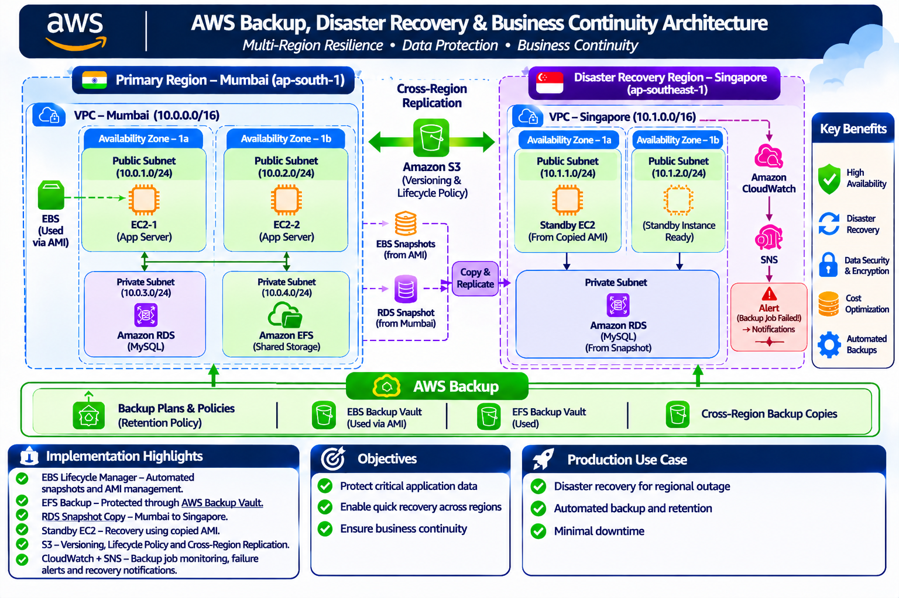<br><sub><b>Reference architecture</b> - Mumbai (primary) to Singapore (DR)</sub></p>

> **Note:** this diagram is the target/reference design. In the lab build the exact CIDRs differ slightly (Mumbai private subnets are 10.0.11.0/24 and 10.0.12.0/24, Singapore VPC is 10.20.0.0/16), and CloudWatch + SNS alerting is documented as an extension in [docs/monitoring-extension.md](docs/monitoring-extension.md). The resource inventory below reflects what was actually built.

**Created by: Atharv Shete** | AWS Cloud & DevOps Engineer

---

## 1. Scenario

A company wants to protect its business data and recover applications when an AWS resource or Availability Zone experiences a failure. This project implements a **backup + disaster recovery (DR) strategy** that covers compute, block storage, shared file storage, object storage and a relational database, and then **proves recovery** by simulating failures and restoring in a second Region.

## 2. Detailed architecture (Mermaid)

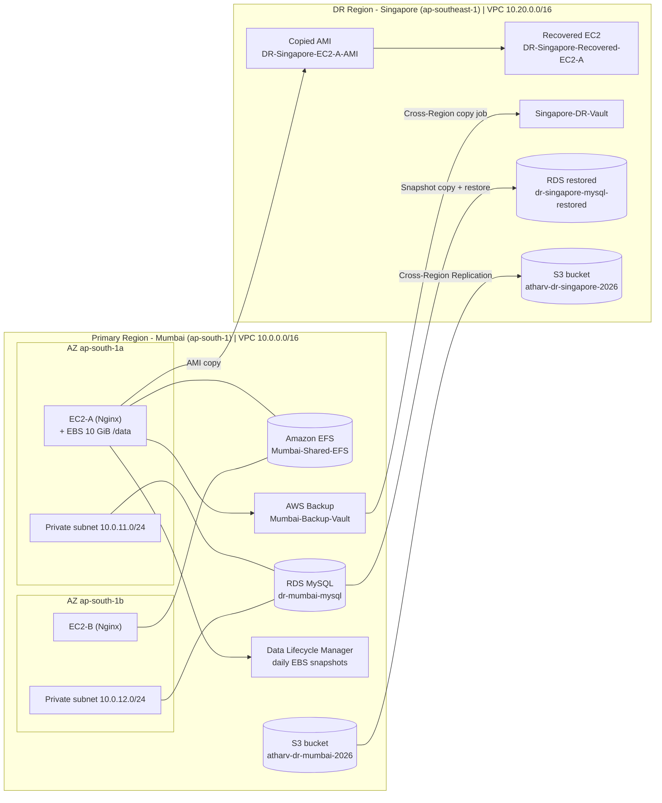

More detail: [docs/architecture.md](docs/architecture.md)

## 3. AWS services used

| Category | AWS Services | Purpose in this project |
|---|---|---|
| Compute | EC2, AMI | Nginx application servers, golden AMI copied to DR Region |
| Block storage | EBS | 10 GiB data volume mounted on `/data` |
| Shared storage | EFS | One file system mounted on two EC2 instances in two AZs |
| Object storage | S3 | Versioned bucket, cross-Region replication, lifecycle rules |
| Database | RDS (MySQL 8.4) | `dr-mumbai-mysql` in private subnets, snapshot + restore in Singapore |
| Backup | AWS Backup, Data Lifecycle Manager | Daily backup plan, vaults, retention, cross-Region copy |
| Recovery | EBS snapshots, RDS snapshots, AMIs | Rebuild compute, volumes and DB after failure |
| Networking | VPC, subnets, route tables, IGW, security groups | 2 public + 2 private subnets across 2 AZs, in 2 Regions |
| Security | IAM, KMS | Service roles, encrypted EFS / backup vault |

## 4. Resource inventory

| Resource | Mumbai (primary) | Singapore (DR) |
|---|---|---|
| VPC | `Mumbai-VPC` 10.0.0.0/16 | VPC 10.20.0.0/16 |
| Subnets | Public 10.0.1.0/24 (1a), 10.0.2.0/24 (1b); Private 10.0.11.0/24 (1a), 10.0.12.0/24 (1b) | Public subnet for recovered EC2 |
| Route tables | `Mumbai-Public-RT` (local + IGW), `Mumbai-Private-RT` (local only) | - |
| EC2 | `Mumbai-EC2-A` (t3.micro), `Mumbai-EC2-B` | `DR-Singapore-Recovered-EC2-A` |
| EBS | 10 GiB gp3 data volume, snapshot, restored volume | - |
| EFS | `Mumbai-Shared-EFS` (encrypted, Elastic throughput, IA after 30 d) | - |
| S3 | `atharv-dr-mumbai-2026` | `atharv-dr-singapore-2026` |
| RDS | `dr-mumbai-mysql` (db.t4g.micro) | `dr-singapore-mysql-restored` |
| AMI | `Mumbai-EC2-A-AMI` | `DR-Singapore-EC2-A-AMI` (copy) |
| Backup vault | `Mumbai-Backup-Vault` | `Singapore-DR-Vault` |
| Backup plan | `DR-Mumbai-Daily-Backup-Plan` / rule `Daily-Backup-Plan` | - |
| DLM policy | `Daily Mumbai EBS Backup Policy` | - |

## 5. Project requirements checklist

| # | Requirement (from project brief) | Status | Evidence |
|---|---|---|---|
| 1 | Deploy an application on EC2 | Done | Figs 10-16 |
| 2 | Attach EBS volumes to EC2 | Done | Figs 17-19 |
| 3 | Create EFS and mount on multiple EC2 instances | Done | Figs 20-27 |
| 4 | Store important files in S3 | Done | Figs 28-30 |
| 5 | Deploy RDS MySQL database | Done | Figs 37-41 |
| 6 | Automated EBS snapshots | Done | Figs 43-46 |
| 7 | Create EC2 AMIs | Done | Figs 47-48 |
| 8 | AWS Backup plans and vaults | Done | Figs 49-55 |
| 9 | Backup retention policies | Done | Fig 51 (7-day retention) |
| 10 | S3 versioning and lifecycle | Done | Figs 31, 58 |
| 11 | Cross-Region backup copies | Done | Figs 32-36, 48, 50, 54-55 |
| 12 | Simulate EC2 failure and restore application | Done | Figs 59-62 |
| 13 | Restore RDS from snapshot | Done | Figs 56-57, 65-66 |
| 14 | Monitor backup/recovery with CloudWatch and SNS | Partial | Backup jobs monitored in AWS Backup console (Figs 54, 68-69); CloudWatch alarms + SNS alerts are documented as an extension in [docs/monitoring-extension.md](docs/monitoring-extension.md) |

## 6. Implementation highlights

### 6.1 Network - two VPCs, two Regions
Mumbai VPC with public and private subnets in two AZs; private subnets host RDS and have no internet route (local route only), which keeps the database isolated and avoids NAT Gateway cost.

<p align="center">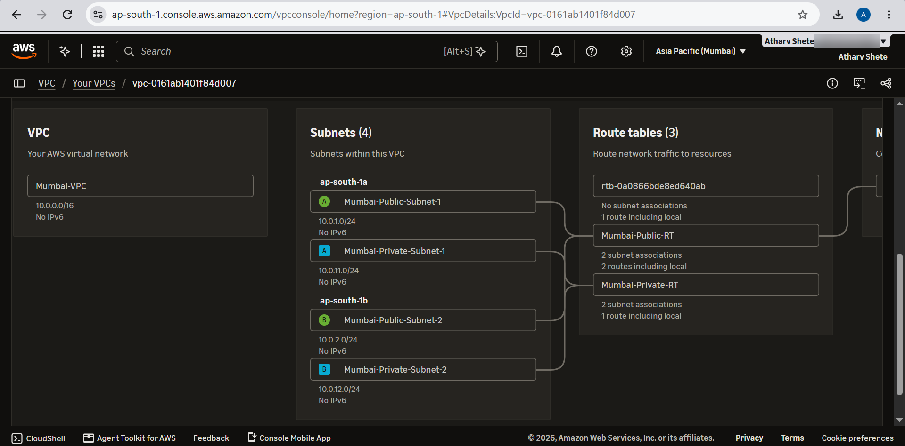<br><sub><b>Figure 01</b> – Mumbai VPC resource map - 4 subnets across ap-south-1a / 1b</sub></p>
<p align="center">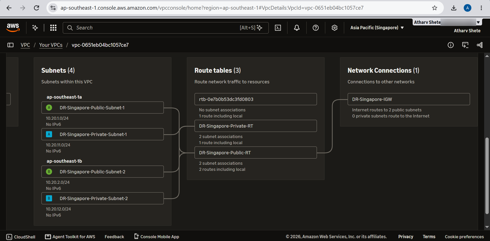<br><sub><b>Figure 04</b> – Singapore VPC resource map - DR Region network</sub></p>

### 6.2 Compute + EBS + EFS
Two Nginx servers in different AZs share one encrypted EFS file system; a separate 10 GiB EBS volume is formatted with XFS and mounted on `/data`.

<p align="center">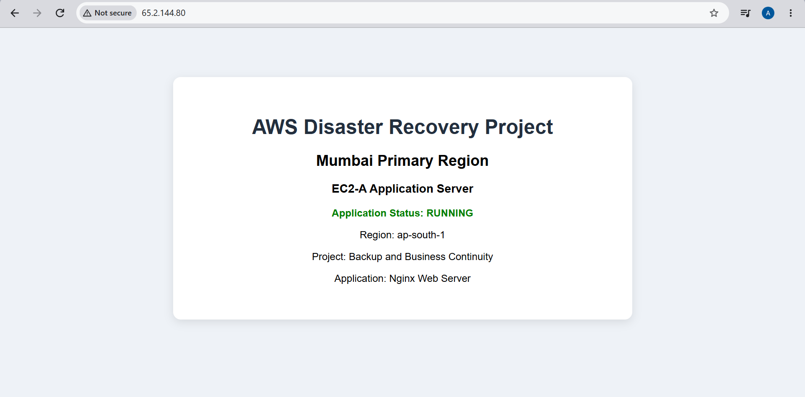<br><sub><b>Figure 13</b> – Application running on Mumbai-EC2-A</sub></p>
<p align="center">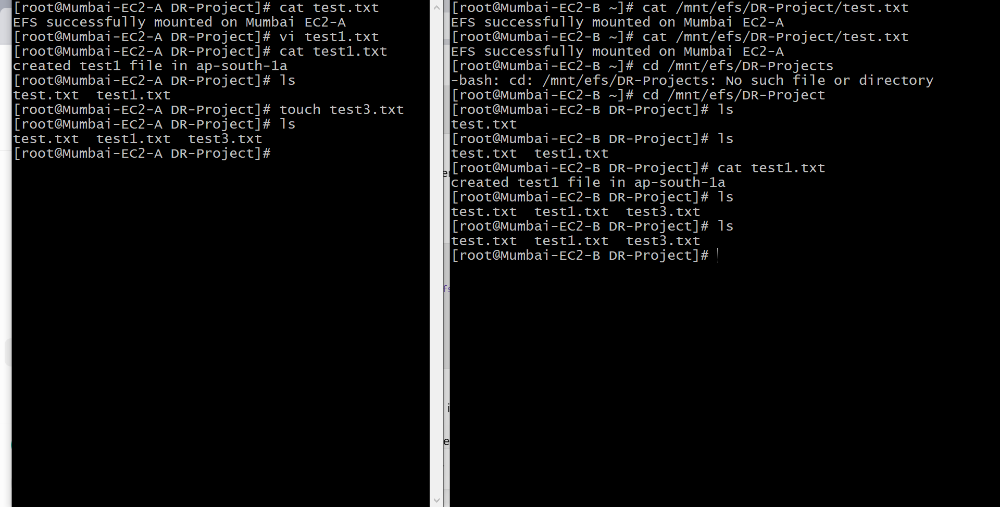<br><sub><b>Figure 27</b> – Files written on EC2-A are visible on EC2-B through EFS</sub></p>

### 6.3 S3 versioning, replication and lifecycle
Mumbai bucket replicates to Singapore (Cross-Region Replication) and has a lifecycle rule for current and noncurrent object versions.

<p align="center">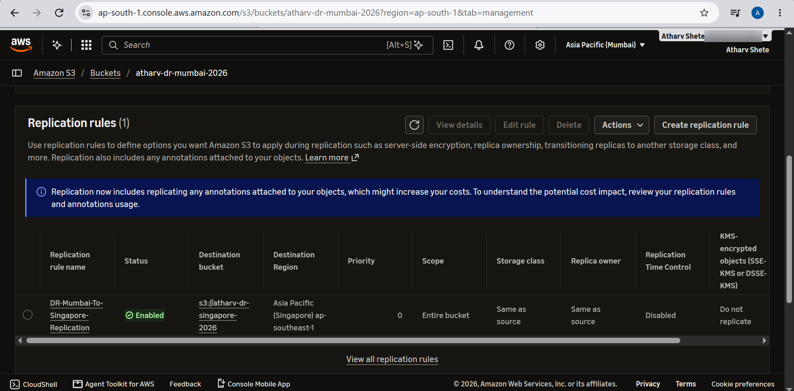<br><sub><b>Figure 35</b> – S3 replication rule Mumbai to Singapore</sub></p>
<p align="center">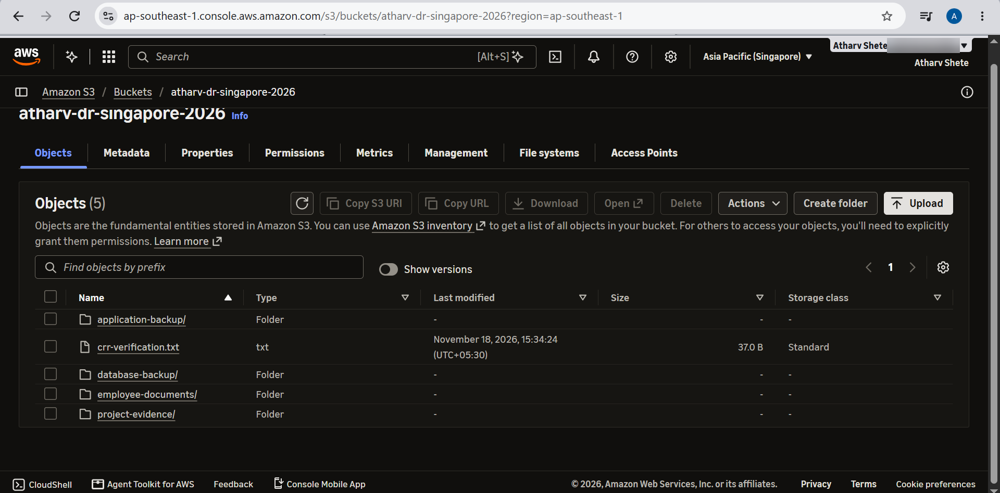<br><sub><b>Figure 36</b> – Replicated objects in the Singapore bucket</sub></p>

### 6.4 RDS MySQL
Database in private subnets via a dedicated DB subnet group; sample `dr_project.employees` table used to prove data integrity after restore.

<p align="center">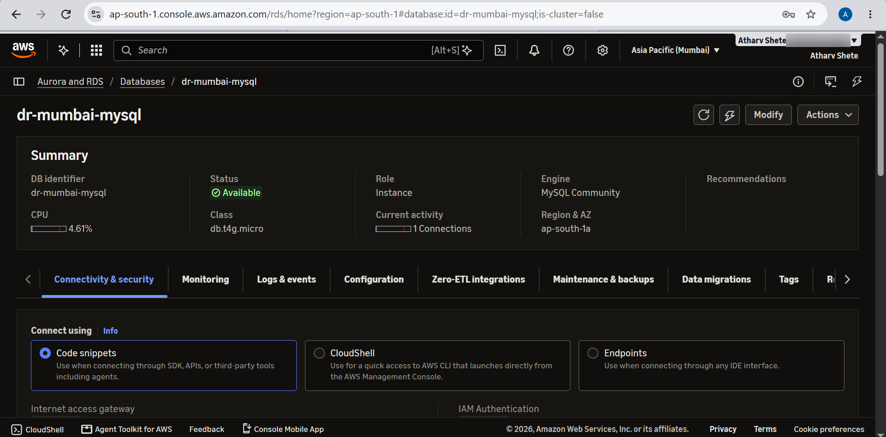<br><sub><b>Figure 39</b> – RDS MySQL dr-mumbai-mysql - Available</sub></p>

### 6.5 Automated protection
Data Lifecycle Manager takes daily EBS snapshots (tag `Name:Mumbai-EC2-A-EBS`), an AMI is baked and copied to Singapore, and AWS Backup runs a daily plan (09:00 IST, 7-day retention) with a cross-Region copy into `Singapore-DR-Vault`.

<p align="center">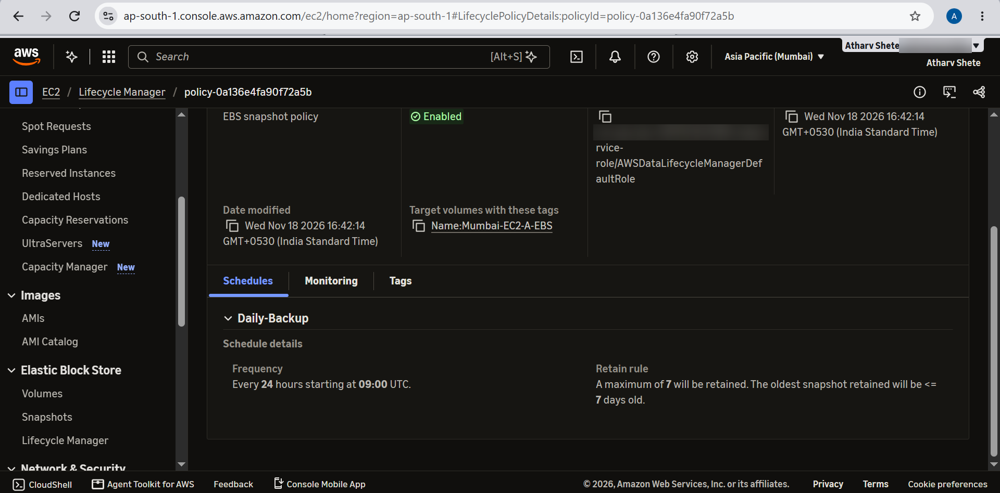<br><sub><b>Figure 45</b> – DLM EBS snapshot policy</sub></p>
<p align="center">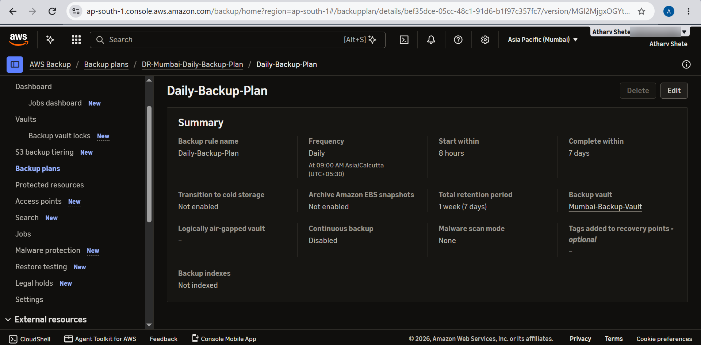<br><sub><b>Figure 51</b> – AWS Backup rule - daily, 7 day retention</sub></p>
<p align="center">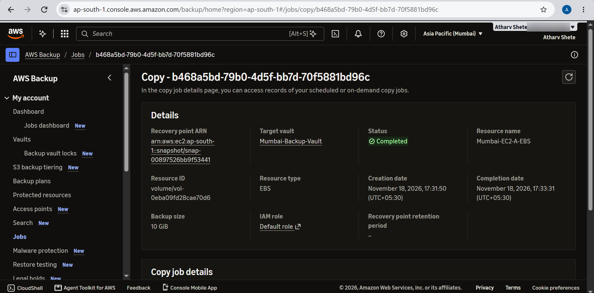<br><sub><b>Figure 54</b> – Cross-Region copy job completed</sub></p>

### 6.6 Disaster-recovery tests
- **EC2 failure:** launched `DR-Singapore-Recovered-EC2-A` in Singapore from the copied AMI and verified the web page responds from a new IP.
- **EBS failure:** restored a volume from backup, attached it to the instance and verified data on `/data`.
- **Database loss:** restored the RDS snapshot in Singapore as `dr-singapore-mysql-restored` and queried the same employee records.

<p align="center">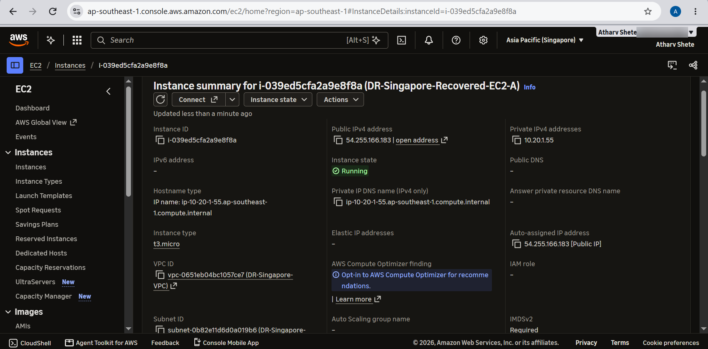<br><sub><b>Figure 62</b> – Recovered EC2 instance running in Singapore</sub></p>
<p align="center">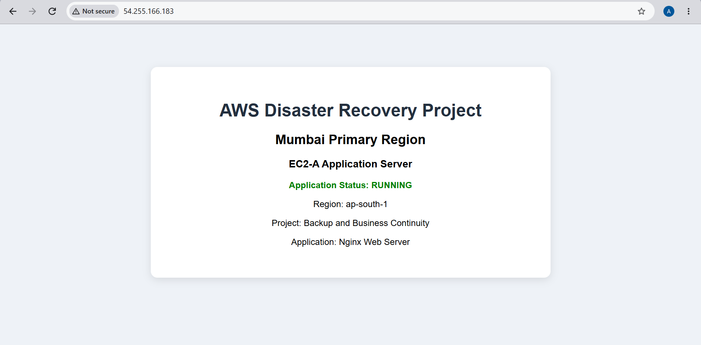<br><sub><b>Figure 61</b> – Application served from the DR Region</sub></p>
<p align="center">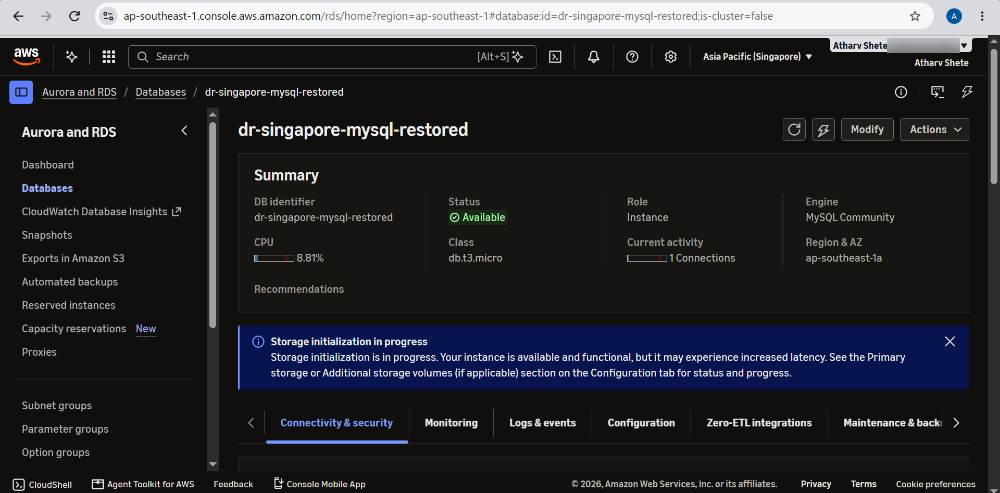<br><sub><b>Figure 66</b> – RDS restored in Singapore</sub></p>

Full step-by-step with all 69 screenshots: **[docs/implementation-guide.md](docs/implementation-guide.md)**

## 7. Recovery objectives (design targets)

| Component | Protection | Target RPO | Target RTO |
|---|---|---|---|
| EC2 / OS | AMI copied to Singapore | Last AMI | ~10-15 min (launch from AMI) |
| EBS data | DLM daily snapshot + AWS Backup daily | 24 h | ~10 min (restore + mount) |
| EFS | EFS automatic backups (AWS Backup) | 24 h | ~15-30 min |
| S3 | Versioning + Cross-Region Replication | Minutes | Immediate (read from replica bucket) |
| RDS | Manual / automated snapshot, copy + restore | Last snapshot | ~15-30 min |

> These are design targets for a lab environment, not SLA-measured values.

## 8. Troubleshooting & lessons learned
Real issues hit during the build (typos in service/dir names, missing database, wrong table name) and runbooks for the six scenarios in the brief are in **[docs/troubleshooting.md](docs/troubleshooting.md)**.

## 9. Cost control / clean-up
Stop or delete EC2, RDS, EFS, extra EBS volumes, snapshots, AMIs, vaults and S3 replication when finished: **[docs/cleanup.md](docs/cleanup.md)**.

## 10. Future improvements
CloudWatch alarms + SNS notifications for failed backup jobs, CloudTrail audit trail, Route 53 failover routing, Infrastructure as Code (Terraform/CloudFormation), AWS Backup Vault Lock, restore testing automation.

## 11. Repository structure
```
.
├── README.md
├── architecture/                   # reference architecture diagram
├── docs/
│   ├── architecture.md
│   ├── implementation-guide.md     # step-by-step with all screenshots
│   ├── disaster-recovery-runbook.md
│   ├── troubleshooting.md
│   ├── monitoring-extension.md
│   ├── cleanup.md
│   └── linkedin-post.md
├── scripts/                        # commands used / reusable snippets
└── screenshots/                    # 69 numbered evidence images
```

## 12. Author
**Atharv Shete** - AWS Cloud & DevOps Engineer | Pune, India
[LinkedIn](https://www.linkedin.com/in/atharv-shete-35642126b) | [GitHub](https://github.com/Atharv0717)

*Account IDs in screenshots are masked.*
