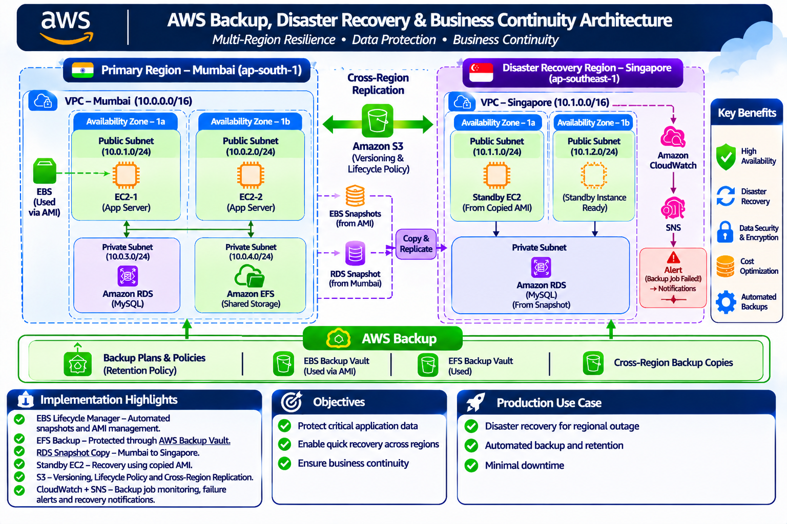
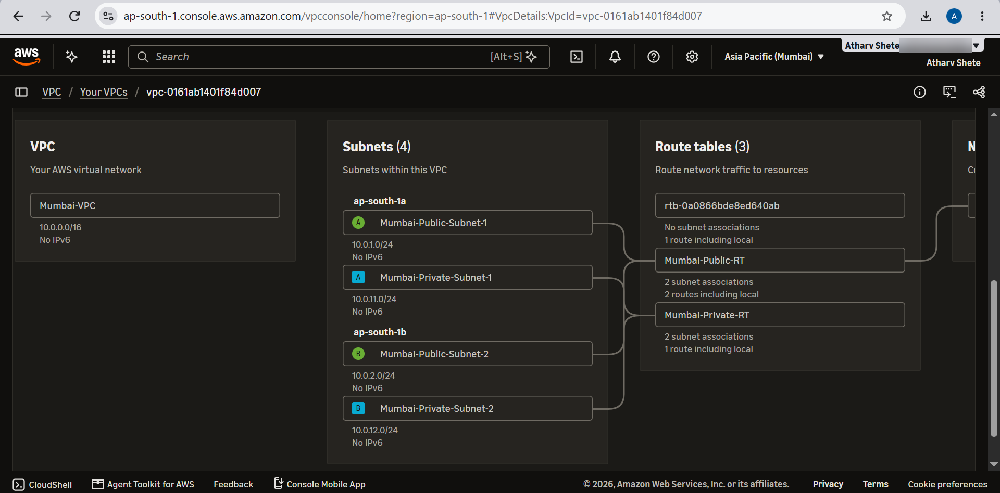
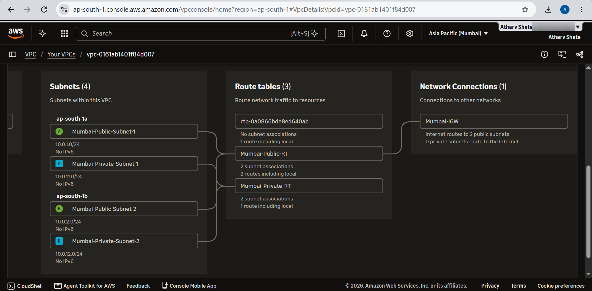
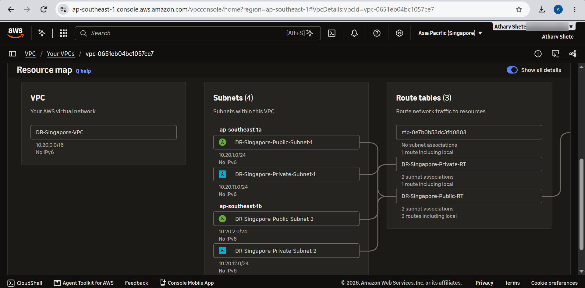
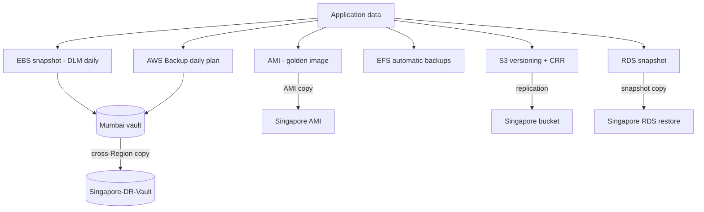
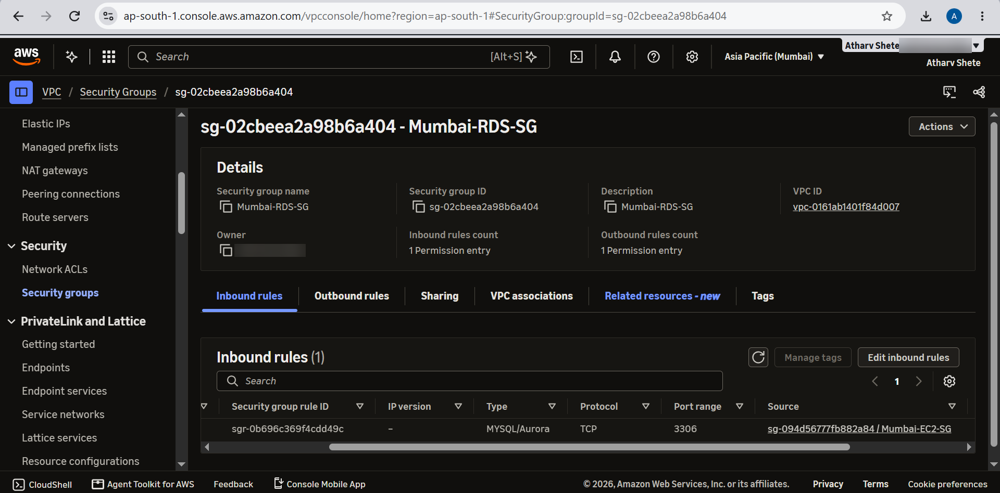
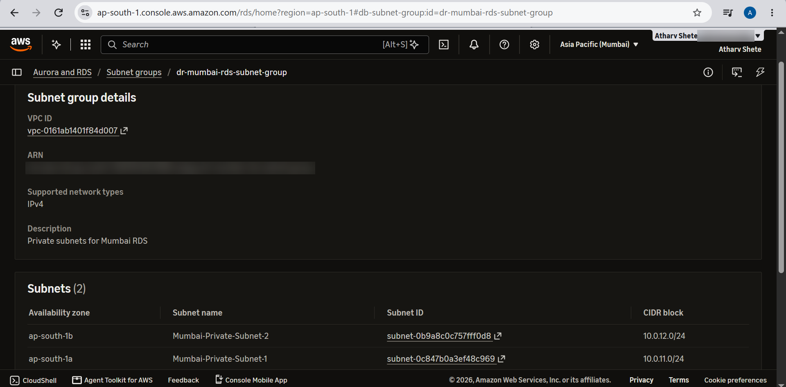

# Architecture

## Design goals
1. Survive failure of a single resource (instance, volume, database).
2. Survive failure of an Availability Zone (two AZs, shared EFS, Multi-AZ-ready subnets).
3. Survive failure of a whole Region (cross-Region AMI, S3 replication, backup copy, RDS snapshot restore).

## Network
| Item | Mumbai (ap-south-1) | Singapore (ap-southeast-1) |
|---|---|---|
| VPC CIDR | 10.0.0.0/16 | 10.20.0.0/16 |
| Public subnets | 10.0.1.0/24 (1a), 10.0.2.0/24 (1b) | recovered EC2 subnet |
| Private subnets | 10.0.11.0/24 (1a), 10.0.12.0/24 (1b) | - |
| Internet access | Internet Gateway on public route table | Internet Gateway |
| Private route table | local route only (isolated DB tier) | - |

 <b>Figure 01</b> – Mumbai VPC resource map

 <b>Figure 02</b> – Subnets and route tables

 <b>Figure 03</b> – Singapore VPC resource map

## Data protection layers

## Security
- Security groups per tier (web, EFS, RDS) with least-privilege rules.
- EFS encrypted with KMS (`aws/elasticfilesystem`); AWS Backup vault encrypted with KMS.
- DLM uses `AWSDataLifecycleManagerDefaultRole`; AWS Backup uses its service role.
- RDS lives in private subnets (DB subnet group `dr-mumbai-rds-subnet-group`).

 <b>Figure 06</b> – RDS security group

 <b>Figure 37</b> – RDS subnet group - two private subnets in two AZs

