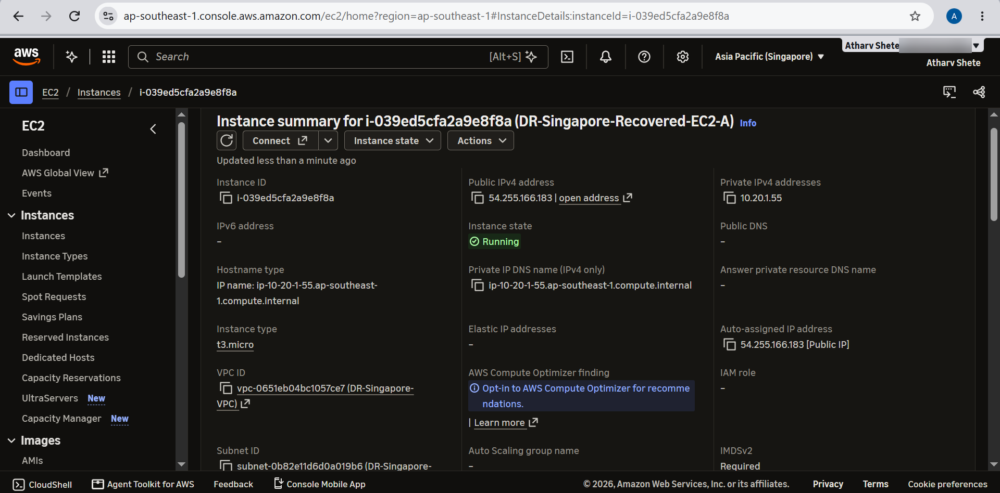
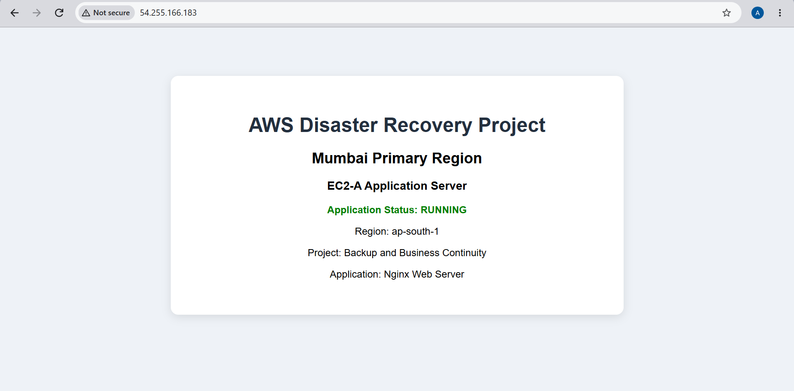
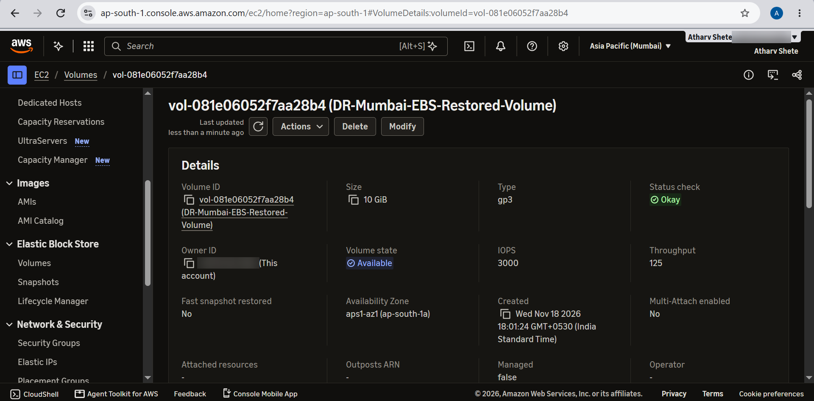
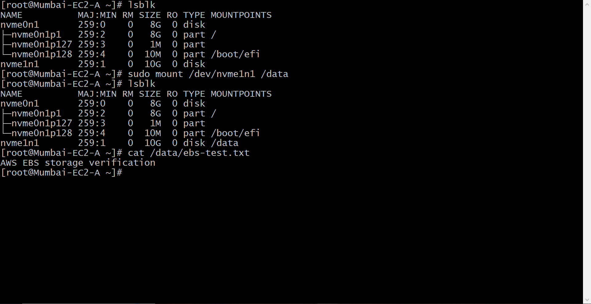
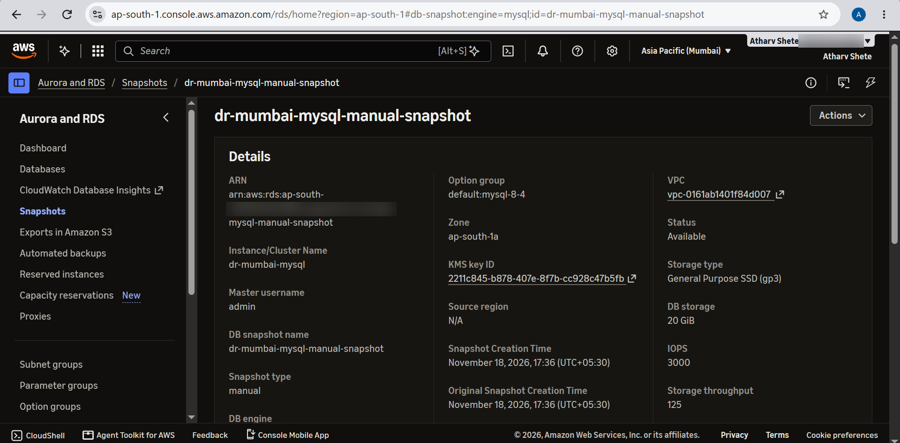
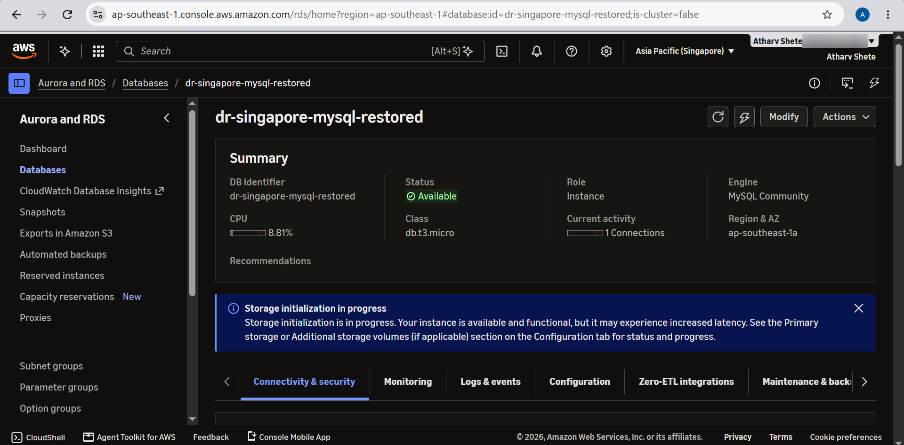
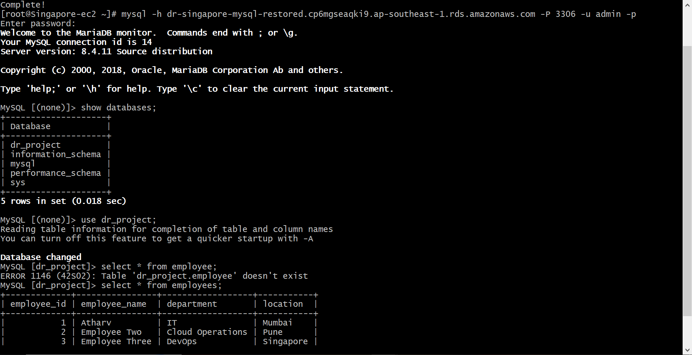
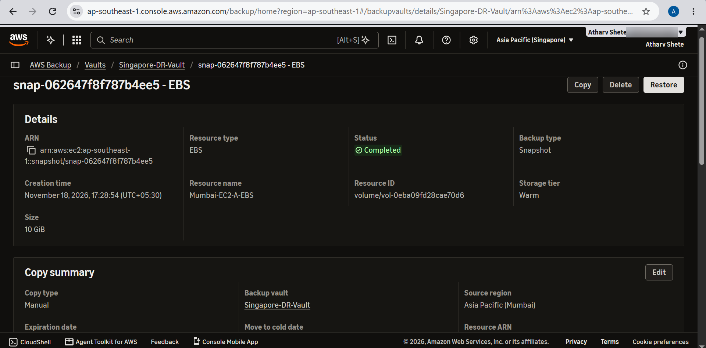

# Disaster Recovery Runbook

Primary: Mumbai (ap-south-1) | DR: Singapore (ap-southeast-1)

## Scenario A - EC2 instance / AZ failure
**Detect:** status checks fail, web page unreachable.
**Recover (same Region):** launch a new instance from `Mumbai-EC2-A-AMI` in another AZ, re-mount EFS and data volume.
**Recover (Region down):** launch from the copied AMI in Singapore.
```bash
aws ec2 run-instances --region ap-southeast-1 \
  --image-id <DR-Singapore-EC2-A-AMI> --instance-type t3.micro \
  --subnet-id <public-subnet> --security-group-ids <web-sg> \
  --tag-specifications 'ResourceType=instance,Tags=[{Key=Name,Value=DR-Singapore-Recovered-EC2-A}]'
```
**Verify:** open `http://<new-public-ip>` and confirm the page loads.

<p align="center"><br><sub><b>Figure 62</b> – Recovered instance running in Singapore</sub></p>
<p align="center"><br><sub><b>Figure 61</b> – Application served from the DR instance</sub></p>

## Scenario B - EBS volume unavailable / corrupted
1. In AWS Backup (or EC2 Snapshots) pick the latest recovery point.
2. Restore to a new volume `DR-Mumbai-EBS-Restored-Volume` in the instance AZ.
3. Attach and mount.
```bash
aws ec2 attach-volume --volume-id <vol-id> --instance-id <i-id> --device /dev/sdf
lsblk
sudo mount /dev/nvme1n1 /data
cat /data/ebs-test.txt
```
<p align="center"><br><sub><b>Figure 63</b> – Restored EBS volume</sub></p>
<p align="center"><br><sub><b>Figure 64</b> – Data verified after restore</sub></p>

## Scenario C - RDS database deleted accidentally
1. Use the latest snapshot (`dr-mumbai-mysql-manual-snapshot` or automated).
2. For Region failure copy the snapshot to Singapore first.
3. Restore as a new DB instance and update the application endpoint.
```bash
aws rds copy-db-snapshot --region ap-southeast-1 \
  --source-db-snapshot-identifier arn:aws:rds:ap-south-1:<ACCOUNT_ID>:snapshot:dr-mumbai-mysql-manual-snapshot \
  --target-db-snapshot-identifier dr-mumbai-mysql-copy
aws rds restore-db-instance-from-db-snapshot --region ap-southeast-1 \
  --db-instance-identifier dr-singapore-mysql-restored \
  --db-snapshot-identifier dr-mumbai-mysql-copy --db-instance-class db.t4g.micro
```
**Verify:** `SELECT * FROM dr_project.employees;`

<p align="center"><br><sub><b>Figure 56</b> – Snapshot of the source database</sub></p>
<p align="center"><br><sub><b>Figure 66</b> – Restored DB in Singapore</sub></p>
<p align="center"><br><sub><b>Figure 65</b> – Data validated after restore</sub></p>

## Scenario D - Whole Region failure (summary)
1. Launch EC2 from copied AMI in Singapore.
2. Read files from replicated S3 bucket `atharv-dr-singapore-2026`.
3. Restore RDS from copied snapshot.
4. Restore EBS/EFS data from the `Singapore-DR-Vault` recovery point.
5. Point DNS to the new endpoint.

<p align="center"><br><sub><b>Figure 55</b> – Recovery point available in Singapore vault</sub></p>
