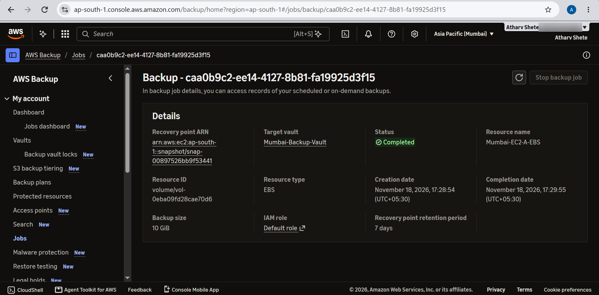

# Monitoring Extension - CloudWatch + SNS (Requirement 14)

AWS Backup job status was monitored from the **Backup jobs** console (see Figs 54, 68, 69). To add proactive alerting:

1. Create SNS topic `dr-backup-alerts` and subscribe your email.
2. In AWS Backup -> Settings enable notifications, or create an EventBridge rule on `Backup Job State Change` with state `FAILED`/`EXPIRED` targeting the SNS topic.
3. Create CloudWatch alarms for EC2 `StatusCheckFailed`, RDS `CPUUtilization` / `FreeStorageSpace`, EFS `BurstCreditBalance`/`PercentIOLimit`.

```bash
aws sns create-topic --name dr-backup-alerts
aws sns subscribe --topic-arn <TOPIC_ARN> --protocol email --notification-endpoint you@example.com
aws backup put-backup-vault-notifications --backup-vault-name Mumbai-Backup-Vault \
  --sns-topic-arn <TOPIC_ARN> --backup-vault-events BACKUP_JOB_FAILED RESTORE_JOB_COMPLETED COPY_JOB_FAILED
```

<p align="center"><br><sub><b>Figure 68</b> – Backup job completed in the AWS Backup console</sub></p>
