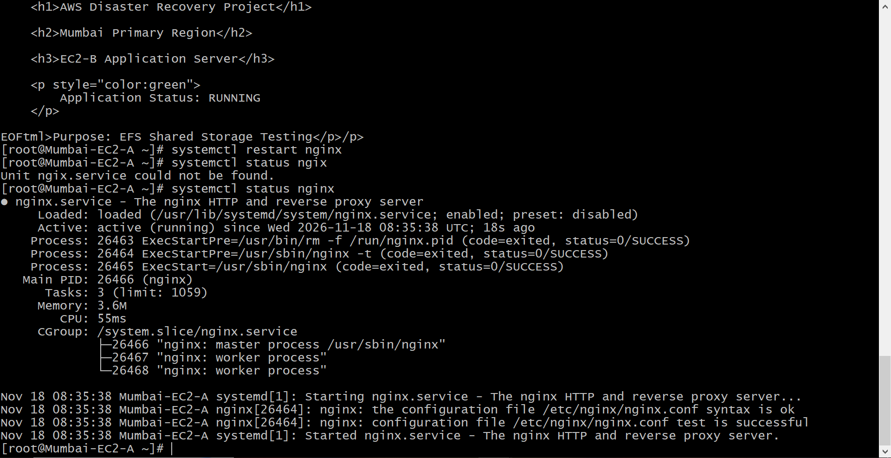
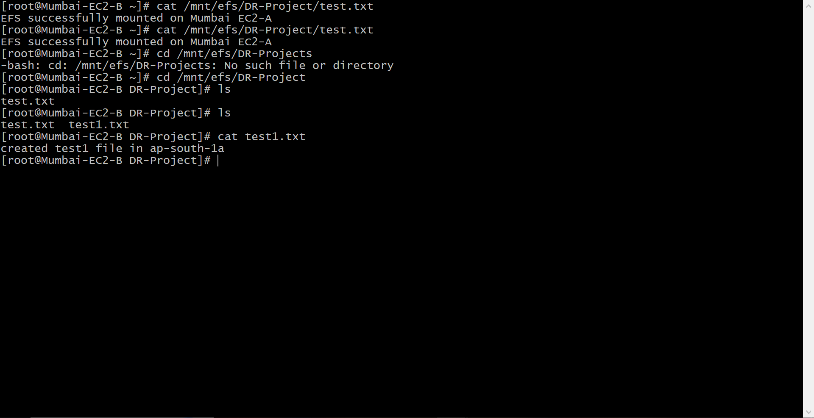
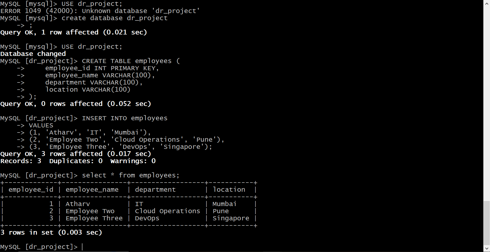
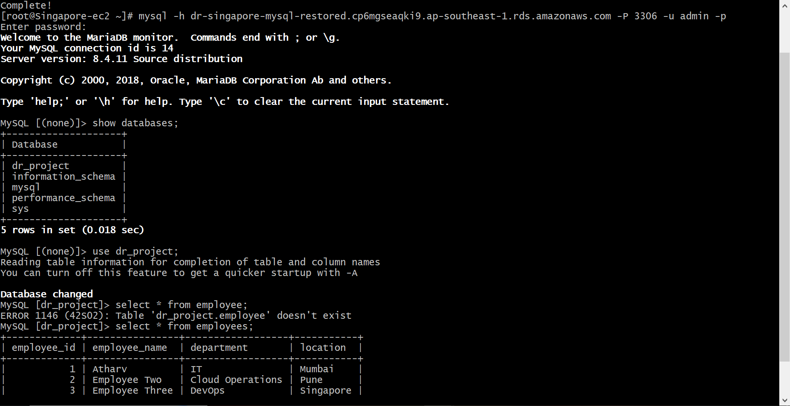

# Troubleshooting

## A. Real issues I hit during this build
| # | What happened | Cause | Fix |
|---|---|---|---|
| 1 | `systemctl status ngix` -> *Unit ngix.service could not be found* | Typo in service name | Use `systemctl status nginx` |
| 2 | `cd /mnt/efs/DR-Projects` -> *No such file or directory* | Wrong directory name (created `DR-Project`) | `cd /mnt/efs/DR-Project` |
| 3 | `ERROR 1049 Unknown database 'dr_project'` | Database not created yet | `CREATE DATABASE dr_project;` then `USE dr_project;` |
| 4 | `ERROR 1146 Table 'dr_project.employee' doesn't exist` | Table is `employees` (plural) | `SELECT * FROM employees;` |

 <b>Figure 12</b> – Nginx service name typo and fix

 <b>Figure 26</b> – Wrong EFS directory name and correct path

 <b>Figure 40</b> – Unknown database error then database creation

 <b>Figure 65</b> – Table-not-found error and correct query

## B. Runbooks for the six scenarios in the project brief

### 1. EC2 instance fails
- **Symptoms:** instance status check failed, site down.
- **Check:** EC2 console -> Status checks; `aws ec2 describe-instance-status`.
- **Fix:** stop/start (moves host); if still failing launch from AMI; attach EBS/EFS.
- **Prevent:** golden AMI, 2 AZs, auto recovery alarm.

### 2. EBS volume becomes unavailable
- **Check:** volume state/status check; `dmesg | tail`.
- **Fix:** restore latest snapshot/recovery point to a new volume, attach, mount.
- **Prevent:** DLM daily snapshots + AWS Backup.

### 3. RDS database deleted accidentally
- **Fix:** restore from snapshot/PITR into a new instance, repoint app.
- **Prevent:** deletion protection, final snapshot, automated backups, cross-Region snapshot copy.

### 4. Backup job fails
- **Check:** AWS Backup -> Jobs -> status message.
- **Common causes:** missing IAM permission on backup role, resource not tagged/assigned, KMS key access, start window too short.
- **Fix:** correct role/KMS policy, widen window, rerun on-demand.

### 5. EFS mount unavailable
- **Check:** `df -h`, `mount | grep efs`, mount target state in each AZ.
- **Causes:** SG missing TCP 2049, `nfs-utils` not installed, DNS resolution disabled, wrong AZ/mount target.
- **Fix:** open 2049 from client SG, install `nfs-utils`, mount via IP or fix DNS settings.

### 6. Application recovery takes longer than expected
- **Causes:** large AMI/snapshot lazy loading, manual steps, DNS TTL.
- **Fix:** use Fast Snapshot Restore for critical volumes, pre-copy AMIs, automate with scripts/IaC, lower DNS TTL, rehearse restores regularly.
